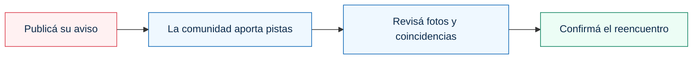
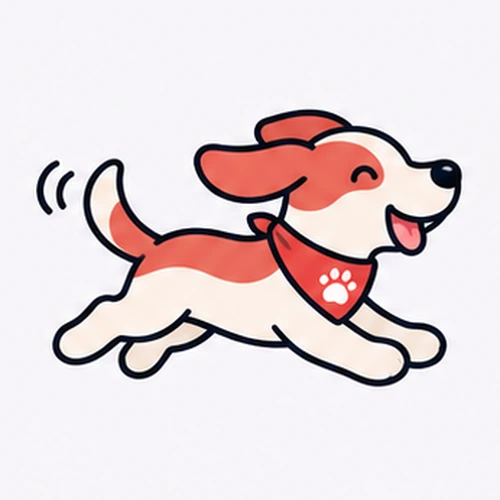

<div align="center">
  <picture>
    <source media="(prefers-color-scheme: dark)" srcset=".github/assets/mascomatch-logo-dark.svg">
    <source media="(prefers-color-scheme: light)" srcset=".github/assets/mascomatch-logo-light.svg">
    
  </picture>

  <h3>Cada pista suma. Cada reencuentro importa.</h3>
  <p>Tecnología y comunidad para ayudar a que más mascotas vuelvan a casa.</p>

  <p>
    <a href="https://github.com/JMolinelliV2/MascoMatch/actions/workflows/ci.yml"></a>
    <a href="docs/FLUJOS_DEL_SISTEMA.md"></a>
    <a href="docs/ai-production.md"></a>
    <a href="docs/FLUJOS_DEL_SISTEMA.md#3-publicar-una-mascota-perdida"></a>
  </p>

  <p>
    <a href="#levantar-en-local"><strong>Empezar</strong></a> ·
    <a href="docs/FLUJOS_DEL_SISTEMA.md">Cómo funciona</a> ·
    <a href="docs/README.md">Documentación</a> ·
    <a href="#tecnologías">Tecnologías</a> ·
    <a href="https://github.com/JMolinelliV2/MascoMatch/issues">Ideas y problemas</a>
  </p>
</div>

---

MascoMatch conecta avisos de perros y gatos perdidos con las pistas de quienes los ven o los tienen a salvo. Reúne fotos, mapas, posibles coincidencias y contacto privado en un mismo lugar. **Publicar y buscar es gratuito**, con aportes voluntarios para sostener el proyecto.

## Qué podés hacer

| Función | Qué aporta |
| --- | --- |
| 🐾 **Publicar una búsqueda** | Avisos con código único, características y hasta cinco fotos, eligiendo la miniatura. |
| 📍 **Compartir una pista** | Avistamientos con dirección, pin ajustable y fotos; desde un aviso se pueden enviar sin cuenta. |
| 🤝 **Avisar que la tenés a salvo** | Desde un aviso: fotos y datos de la mascota primero; contacto después de que el dueño confirme su identidad. |
| 🔎 **Revisar posibles coincidencias** | Comparación de fotos y características con modelos locales, acompañada de revisión humana. |
| 🔔 **Seguir las novedades** | Alertas en la web y por correo, con lectura, archivo y preferencias por cuenta. |
| 🛠️ **Administrar la comunidad** | Panel privado con moderación, usuarios, trabajos, correos, respaldos y seguimiento de recomendaciones. |

## De una pista a un reencuentro



Los reportes enviados desde una ficha llegan al dueño aunque la IA siga pendiente. En **La tengo conmigo**, el contacto se revela después de reconocer a la mascota. Reconocerla y confirmar que ya volvió a casa son acciones distintas.

## Tecnologías

| Parte del proyecto | Tecnologías |
| --- | --- |
| Interfaz | Next.js · React · TypeScript · Tailwind CSS |
| API y datos | Python · FastAPI · SQLAlchemy · Alembic |
| Búsqueda y persistencia | PostgreSQL · PostGIS · pgvector |
| IA en infraestructura propia | Gemma / Ollama · Pet-ReID · RF-DETR · OpenCLIP |
| Trabajos en segundo plano | Redis · RQ |
| Mapas y direcciones | Leaflet · OpenStreetMap · Photon |
| Despliegue y fotos | Docker Compose · Caddy · SeaweedFS en producción / MinIO en desarrollo |
| Correo, operación y aportes | SMTP · Prometheus · Backblaze B2 · Mercado Pago |

La [guía de arquitectura](docs/architecture.md) explica qué hace cada pieza y cómo se relacionan.

## Documentación

El [índice de documentación](docs/README.md) reúne las guías vigentes. Para comenzar:

- [Flujos implementados, puntos de entrada y permisos](docs/FLUJOS_DEL_SISTEMA.md).
- [Tecnologías y arquitectura](docs/architecture.md).
- [Instalación de producción paso a paso](docs/puesta-en-produccion-paso-a-paso.md).
- [Operación, correo, actualizaciones y respaldos](docs/production.md).

## Levantar en local

Requisitos: Docker Desktop iniciado, Docker Compose v2 y los puertos locales disponibles: 3000, 8000, 5432, 6379, 9000 y 9001. Mailpit utiliza además el 8025 cuando se habilita su perfil.

Desde la carpeta del repositorio, en PowerShell:

```powershell
if (!(Test-Path -LiteralPath .env)) { Copy-Item .env.example .env }
docker compose up --build
```

El `.env` es privado. No reemplazar una configuración existente con el ejemplo. Las imágenes de PostgreSQL/PostGIS/pgvector y MinIO se construyen según los archivos de `infrastructure/docker`; la primera construcción puede tardar. La API local aplica las migraciones antes de iniciar. La web de desarrollo comprueba cambios de archivos para funcionar también en Windows/OneDrive.

| Servicio | Dirección local |
| --- | --- |
| Web | [localhost:3000](http://localhost:3000) |
| API y OpenAPI | [localhost:8000/api/v1/docs](http://localhost:8000/api/v1/docs) |
| Estado de API | [localhost:8000/health](http://localhost:8000/health) |
| Consola MinIO | [localhost:9001](http://localhost:9001) |
| Mailpit, si está habilitado | [localhost:8025](http://localhost:8025) |

Para detener conservando los datos:

```powershell
docker compose down
```

No agregar `-v` si se quieren conservar base, fotos y modelos. Clonar o hacer push no copia esos datos.

## Correo de desarrollo

El registro necesita un transporte de correo activo. Para probar sin enviar mensajes externos, editar el `.env` privado:

```dotenv
MAIL_DELIVERY_MODE=preview
SMTP_HOST=mailpit
SMTP_PORT=1025
SMTP_TLS_MODE=none
SMTP_USERNAME=
SMTP_PASSWORD=
PUBLIC_SITE_URL=http://localhost:3000
```

Aplicar y abrir el buzón local:

```powershell
docker compose --profile mail-local up -d --build
```

Los enlaces de confirmación y recuperación se consultan en Mailpit. `preview` no envía a la casilla real. Para correo real, usar `smtp` y configurar el proveedor según [operación](docs/production.md#correo-y-contacto). `restart` no aplica cambios de variables; recrear con `up -d`.

## IA local

La publicación no espera una inferencia. Con la IA habilitada, Gemma extrae características y Pet-ReID representa las fotos de perros/gatos, con detector local y OpenCLIP como alternativa explícita. PostgreSQL conserva los trabajos; Redis/RQ los entrega a los workers.

La [guía de IA](docs/ai-production.md#instalación-en-desarrollo-local) contiene instalación de pesos fijados, configuración, backfill y evaluación. No basta con activar una variable: deben estar instalados los modelos y levantados los workers. El operador acepta los términos de Gemma antes de su primera instalación. No se necesita una API paga de IA.

## Comprobaciones de desarrollo

API, con Python 3.12 y desde `apps/api`:

```powershell
python -m venv .venv
.\.venv\Scripts\Activate.ps1
python -m pip install -r requirements.lock
$env:APP_ENV="test"
$env:MAIL_DELIVERY_MODE="disabled"
$env:AI_ENABLED="false"
$env:EMBEDDINGS_ENABLED="false"
python -m pytest -q -p no:cacheprovider
```

La suite ordinaria utiliza bases temporales y proveedores simulados. Las integraciones reales se activan por separado, en entornos desechables. No usar las cuentas o publicaciones reales como fixtures.

Web, con Node.js 22 y desde `apps/web`:

```powershell
npm ci
npm test
npm run typecheck
npm run build
```

GitHub Actions ejecuta comprobaciones de API/web, migraciones PostgreSQL, reglas de monitoreo y dependencias. Un resultado antiguo de pruebas no acredita el estado de una revisión nueva.

## Producción

[El procedimiento de instalación](docs/puesta-en-produccion-paso-a-paso.md) usa `compose.production.yml` en un VPS Linux, separado del Compose local. Web, API, base, fotos, cola y modelos corren allí; no dependen de que la PC personal esté encendida. Se generan secretos propios y no se copian credenciales de desarrollo.

SMTP, DNS, búsqueda de direcciones, [B2](docs/backblaze-backup.md), [Mercado Pago](docs/mercado-pago-configuracion.md) y el receptor de alertas se configuran y comprueban por instalación. El repositorio no demuestra que esas cuentas externas ya estén operativas.

## Estructura

```text
apps/api/                   API, workers, modelos de datos, migraciones y tests
apps/web/                   Páginas, componentes, mapas y proxies de sesión
infrastructure/docker/      Imágenes de servicios de datos
infrastructure/production/  HTTPS, permisos y monitoreo
tools/                      Inicialización, despliegue y validación aislada
test-data/                  Fixtures y formatos de evaluación
docs/                       Guías vigentes
```

## Ideas, mejoras y apoyo

¿Encontraste un problema o se te ocurrió una mejora? [Abrí un issue](https://github.com/JMolinelliV2/MascoMatch/issues) con el recorrido, lo que esperabas y lo que ocurrió. Para cambios de código, una pull request debe explicar el propósito y las comprobaciones realizadas.

Los aportes voluntarios puntuales se integran mediante Mercado Pago en UYU; su configuración y pruebas están en la [guía de aportes](docs/mercado-pago-configuracion.md). Ayudan a sostener infraestructura, correo, respaldos y procesamiento de IA.

<div align="center">
  
  <p><strong>Por más mascotas de vuelta en casa. 🐾</strong></p>
</div>
