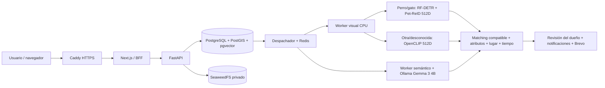

# Entrega de la mejora de IA de MascoMatch

16 de octubre de 2026. Revisión previa a commit/push. Referencia anterior preservada: `b047666025bf26451cf3a3a6e47deeb0036c9eef`, etiqueta `previo-al-cambio-de-modelo-de-ia`.

## 1. IMPLEMENTED

- Proveedores locales separados: Pet-ReID para perros/gatos; OpenCLIP para otras especies/desconocido y fallback explícito. Gemma 3 4B se mantiene para atributos.
- `EmbeddingSpec` inmutable con proveedor, modelo, revisión, dimensión y preprocessing. La compatibilidad se verifica antes de calcular cosenos. Cambios de especie/foto/configuración generan trabajos nuevos sin borrar representaciones históricas.
- Detección RF-DETR Nano CPU, crop con margen, fallback controlado, resolución/blur/confianza/área como señales de calidad. Reutilización del crop vigente para Gemma.
- Instaladores con revisiones y hashes fijados, almacenamiento persistente y comprobación sin Internet. No hay descarga de pesos en peticiones, código remoto de modelos ni API paga de IA.
- Matching por todas las parejas de fotos compatibles; agregado mejor 70% + segunda 30%, calibración por proveedor, calidad visual, atributos, geografía y tiempo. Contradicciones y requisitos mínimos para alertas.
- Avistamientos vinculados siempre generan aviso neutral al dueño; una imagen parecida o la especie heredada no bastan para declarar una coincidencia.
- Dos workers persistentes, colas urgente/normal/backfill, deduplicación, leases, watchdog, recuperación y backfills idempotentes. Gemma no bloquea indefinidamente la publicación ni el matching parcial.
- Gemma con contexto/salida ajustados mediante benchmark, prompts versionados, capacidades cacheadas, keep-alive, prewarm con exclusión mutua, timeouts separados y reintentos solo de fallos transitorios.
- Métricas privadas por fase, colas, errores, cold-start/prewarm, carga de modelo, percentiles, throughput y recortes. Readiness de infraestructura y de IA separados.
- Exportación de etiquetas explícitas del dueño sin entrenamiento automático. Evaluador por identidad con Top-1/3/5, Recall@1/5, falsos positivos, positivos/negativos difíciles, latencia y versiones; validación contra fuga entre splits y fotos duplicadas.
- Migración aditiva, instalación productiva automatizada, verificación de release, rollback por banderas y smoke tests aislados. Docker con límites, redes privadas, modelos persistentes y secretos por rol.
- Corrección de las causas raíz de las pruebas anteriores y ampliación de CI. Documentación de licencias, configuración, despliegue y operación.

Cobertura de las fases solicitadas: 0/36 (auditoría, tests y CI); 1/37 (licencias e integridad); 2–13 (sistema visual y alertas); 14–28/31 (Gemma y ejecución); 29–30 (labels/evaluación); 32–35/38–41 (operación, despliegue, migraciones, rollback y smoke). El criterio 42 se separa de la disponibilidad del servidor público y de la eficacia aún no medida con casos reales.

## 2. TEST RESULTS

La auditoría inicial obtuvo **80 fallos, 81 aprobados y 6 omitidos en 25,77 s**. Las causas incluyeron fixtures que publicaban con cuentas sin confirmar, expectativas anteriores de notificaciones/campos, lectura multipart, límites de reenvío y migraciones iniciales que importaban el ORM actual. Se conservaron pruebas explícitas de rechazo de cuentas sin confirmar; no se eliminó esa protección.

Resultados finales y comandos (desde la raíz del repositorio; los comandos Python se ejecutaron dentro de contenedores con las dependencias fijadas):

| Comprobación | Comando / resultado |
| --- | --- |
| Backend normal | `python -m pytest apps/api/tests -q -p no:cacheprovider`, con `PYTHONPATH=apps/api`, IA/embeddings/correo desactivados: **204 aprobados, 6 integraciones omitidas en 65,11 s**. Las integraciones se ejecutan por separado. |
| Frontend | `npm test` en `apps/web`: **31 aprobados, 0 fallos**. |
| Build frontend | `npm run build`: **correcto**, rutas compiladas. |
| Auditoría frontend | `npm audit --omit=dev --audit-level=high`: **0 vulnerabilidades informadas**. |
| Auditoría API | `python -m pip_audit -r apps/api/requirements.lock`: **0 vulnerabilidades conocidas**. |
| Auditoría worker CPU instalado | `pip freeze`, normalización del sufijo `+cpu`, `python -m pip_audit --no-deps --disable-pip -r /tmp/upstream-packages.txt`: **0 vulnerabilidades conocidas**. |
| Construcción | API y `apps/api/Dockerfile.worker`: **correctas**; `pip check` incluido. |
| Compose | `docker compose --env-file .env.production -f compose.production.yml --profile ai-local --profile setup --profile smoke --profile monitoring config --quiet`: **correcto**. |
| Migraciones PostgreSQL reales | `RUN_VISUAL_MIGRATION_TESTS=1`, base desechable, `test_visual_migrations_integration.py`: **1 aprobado en 5,75 s**. Instalación vacía, 0021→0022, repetición y conservación de vector legacy. |
| BFF y SMTP TLS de producción | `python tools/production_validate.py --keep`: **10 comprobaciones correctas**: registro, rechazo previo a confirmar, correo capturado, confirmación, token privado, cookie segura, aviso, foto, CSRF y revocación al salir. |
| Restauración cifrada | Mismo procedimiento, `test_production_integration.py`: **1 aprobado en 2,44 s**. PostgreSQL y hashes de fotos restaurados; destino no vacío rechazado. |
| Smoke IA sobre stack productivo | `python -m app.ops.ai_smoke`: **12 comprobaciones correctas**. Ocho embeddings reales en **19,51 s**, más Gemma texto/imagen, colas, outbox sin correo externo, idempotencia y crop. |
| Ranking real por proveedor | `RUN_MATCHING_INTEGRATION=1`, `test_matching_integration.py`: **2 aprobados en 22,40 s** con OpenCLIP y Pet-ReID. |
| Gemma y correo de avistamientos | `RUN_LINKED_INTEGRATION=1 RUN_LOCAL_AI_TESTS=1`, pruebas `test_linked_integration.py` y `test_local_ai_integration.py`: **2 aprobados en 288,41 s**. Atributos reales texto/imagen, aviso neutral, foto privada, correo agrupado capturado en Mailpit y ausencia de duplicados. |
| Modelos sin Internet | Contenedor con `--network none`, `python -m app.embeddings.setup --check`: **3 modelos cargados y verificados**. Gemma existente también coincide con su manifiesto/blobs fijados. |
| Alertas y bootstrap | `promtool check rules`: **7 reglas válidas**. `sh -n tools/bootstrap_server.sh`: **correcto**. |

Las pruebas normales no descargan ni ejecutan modelos. Las integraciones se habilitan mediante flags y usan bases/esquemas, colas y objetos temporales. El SMTP del smoke apunta a Mailpit; no envía a usuarios. No se afirma que GitHub Actions remoto haya corrido: los cambios aún no se publicaron.

Evidencia portable, sin secretos ni fotos de usuarios: [benchmarks y metodología](benchmarks/README.md). Los logs completos locales están en `real-data/`, excluido de Git.

La instalación local real fue respaldada, migrada y reprocesada: cinco embeddings nuevos y doce análisis nuevos. Al finalizar el backfill: **10 embeddings, 13 análisis de texto y 10 de imagen exitosos**, incluyendo históricos; ningún pendiente/fallido. Esos números son un snapshot, no una métrica de eficacia.

## 3. PRODUCTION ARCHITECTURE



Todo se ejecuta y almacena en el VPS. La PC personal no es necesaria para producción. Solo Caddy publica 80/443; Prometheus se limita a loopback. DB, Redis, fotos y Ollama no tienen puertos públicos. Los modelos se montan en lectura en los procesos de servicio; el instalador dispone de escritura explícita. API no importa runtimes pesados de inferencia.

## 4. MODEL LICENSING

| Componente | Revisión fijada | Licencia / uso |
| --- | --- | --- |
| `open-noodle/pet-recognition-base` | `fa30eb7785ceb764d5c2840c4585fb89821be385` | Checkpoint Apache-2.0; runtime ONNX MIT. Señal de identidad perro/gato. |
| `open-noodle/rfdetr-nano` | `1618db5f22919339f4347d436da8c43afaf91926` | Código/pesos Nano Apache-2.0; detector CPU. |
| `timm/vit_base_patch32_clip_224.openai` | `a6f597a30f7b82c51704746581f9a4e41421e878` | CLIP/OpenCLIP MIT; conversión Apache-2.0. Fallback multiespecie. |
| `gemma3:4b` | Manifiesto `a2af6cc3eb7fa8be8504abaf9b04e88f17a119ec3f04a3addf55f92841195f5a` | Gemma Terms of Use y Prohibited Use Policy; uso comercial condicionado, aceptación explícita en una instalación nueva. Ollama MIT. |

Los hashes completos, contratos de entrada/salida, dependencias y fuentes oficiales están en [third-party-models.md](third-party-models.md). La proyección Pet-ReID declara Dogs-World CC0 y Cat Individual Images CC BY 4.0. Se verificó la procedencia declarada, no la titularidad individual de cada foto. No se incorporó código AGPL de Gallery ni Ultralytics, ni modelos no comerciales.

## 5. GEMMA OPTIMIZATION RESULTS

No se cambió Gemma 3 4B. Configuración final: 4096 tokens de contexto, 768 de salida, tres threads, una generación simultánea, keep-alive 15m, prewarm, capacidades cacheadas una hora, timeout de texto 120 s e imagen 240 s. Imágenes RGB/JPEG 88, máximo 1024 px, sin upscale, orientación EXIF corregida y crop cuando corresponde.

| Medida | Anterior | Final |
| --- | ---: | ---: |
| `num_ctx` / `num_predict` | 8192 / 4096 | 4096 / 768 |
| Imagen máxima | 1024 px | 1024 px |
| Keep-alive | 5m | 15m |
| Texto p50 / p95 | 38,87 / 48,36 s | 35,13 / 40,98 s |
| Visión p50 / p95 | 80,08 / 82,79 s | 68,45 / 75,50 s |
| Texto cold / warm | 48,36 / 38,02–38,87 s | 40,98 / 30,07–36,88 s |
| Visión cold / warm | 78,33–82,79 s / no medido | 72,98–75,50 / 31,74–68,45 s |
| Carga Gemma en texto cold | 8,61 s | 5,67 s |
| Carga Gemma en visión cold | 3,83–5,09 s | 3,58–3,83 s |
| Carga warm | Milisegundos | 1–4 ms |
| Snapshot RAM Ollama durante visión | 7,12 GiB | 7,03 GiB |
| CPU Ollama activa | Aproximadamente tres cores | Aproximadamente tres cores |
| JSON texto válido | 3/3 | 6/6 |
| JSON visión válido | 4/4 | 8/8 |
| Timeouts / respuestas incompletas | 0 | 0 |
| Comprobaciones de texto erróneas | 0/9 | 0/28 |
| Especie visual errónea | 1/4 | 0/8 |
| Dos solicitudes de texto concurrentes, tiempo total | 75,80 s | 71,96 s |

Se probaron también 4096/512/768: texto p50/p95 30,34/44,24 s; visión 78,77/87,90 s. Se mantuvo 1024 px por detalle y estabilidad. TEXT v2 se descartó pese a ser más rápido: las comprobaciones ampliadas detectaron pérdida de color secundario y texto libre en inglés; la versión final es TEXT v3, VISION v2.

El benchmark anterior y el final tienen tamaños de muestra y prompts distintos. No es una estimación estadística de precisión general. La comparación de CPU no es un perfil continuo del VPS, y la pequeña reducción de RAM no debe venderse como un gran ahorro. Dos solicitudes simultáneas se encolaron con `OLLAMA_NUM_PARALLEL=1`; no se observó una razón para aumentar el paralelismo del servidor.

## 6. RESOURCE USAGE

Entorno medido: VM Docker Desktop x86_64, 20 CPU lógicas, 15,46 GiB asignados. Inferencia local CPU. GiB = 1024³ bytes.

| Componente | Memoria medida | CPU / latencia de referencia | Pesos |
| --- | --- | --- | ---: |
| Gemma / Ollama | Descartado de RAM ~106 MiB; cargado ocioso ~4,28 GiB; snapshot activo visión ~7,03 GiB | 3 threads; decenas de segundos por generación | 3.338.801.804 bytes |
| Pet-ReID en proceso aislado | RSS cargado 0,44 GiB; pico 0,72 GiB | Cold 1,51 s; warm ~0,45 s; CPU warm ~0,90 s | 348.108.213 bytes |
| OpenCLIP en proceso aislado | RSS cargado 0,96 GiB; pico 1,49 GiB | Cold 4,03 s; warm 0,32–0,34 s; CPU warm ~0,39–0,41 s | 605.143.284 bytes |
| Detector en proceso aislado | RSS cargado 0,37 GiB; pico 0,62 GiB | Cold 1,00 s; warm 0,43–0,47 s; CPU warm ~0,86–0,93 s | 107.835.234 bytes |
| Worker visual con los tres modelos | Pico RSS real del smoke **1,65 GiB**; snapshot cgroup **2,52 GiB**, incluyendo cachés | 8 embeddings de cuatro rutas en 19,51 s | Compartidos en un volumen |
| API + web + DB + Redis + fotos, preview ocioso | Snapshot aproximado **0,53 GiB** | No es una prueba de carga | Datos variables |
| Stack completo | Estimación **10–13 GiB activo**, según modelos/cachés; aproximadamente **3–6 GiB ocioso con modelos retenidos** | No se midió un pico simultáneo continuo del stack completo | Pesos totales **4,10 GiB** + imágenes Docker + fotos + backups |

RSS incluye runtime y decodificación de imágenes. Los picos aislados no son aditivos. El worker semántico también puede conservar un detector; está contemplado en el presupuesto.

Límites productivos: Ollama **10 GiB / 3,5 CPU**, worker visual **4 GiB / 2 CPU**, worker semántico **1,5 GiB / 0,5 CPU**, DB **2 GiB / 1,5 CPU**, Redis **512 MiB / 0,5 CPU**, fotos **1 GiB / 1 CPU**, API 768 MiB, web 512 MiB, Caddy 256 MiB, Prometheus 512 MiB, backup 3 GiB. Los límites son techos, no reservas ni garantía de que todos puedan alcanzar su máximo simultáneamente. Ollama y worker visual tienen más del 30% de margen sobre las mediciones disponibles.

Punto de partida: **8 vCPU, 24 GB RAM, 100 GB SSD**. Un piloto con 16 GB exige observar consumo y cola; no se promete capacidad para un volumen de tráfico desconocido. El tamaño de disco contempla espacio operativo, no una cantidad garantizada de fotos. Precio y servidor se eligen con el titular antes de contratar.

## 7. MIGRATIONS

`0022_visual_spaces` añade a los trabajos prioridad, versión de preprocessing, métricas y un índice de despacho. Añade a los embeddings proveedor, revisión, preprocessing, espacio inmutable, calidad e índices. Conserva vectores existentes como legacy y deja generar la versión vigente en paralelo.

Se congeló el DDL histórico de `0001` y `0006`, que antes dependía de `Base.metadata` actual y rompía una instalación nueva. No cambia una instalación que ya aplicó esas revisiones. Se probaron instalación vacía, actualización desde 0021 y repetición, preservando un vector histórico.

El despliegue aplica Alembic y permisos automáticamente; no necesita SQL manual. Antes de actualizar la instalación local se creó `real-data/mascomatch-before-ai-0022.dump` (privado). La migración no tiene downgrade destructivo: la reversión operativa se hace con flags o restaurando una copia anterior en destinos vacíos.

## 8. DEPLOY COMMANDS

Requisitos humanos: servidor/acceso, autorización de licencia, DNS y correo del dominio. Después de revisar y publicar esta entrega, obtener **esa revisión aprobada**, no el `main` previo. Desde Ubuntu 24.04 x86_64 con una cuenta administradora:

```sh
sudo apt-get update
sudo apt-get install -y git python3
git clone https://github.com/JMolinelliV2/MascoMatch.git
cd MascoMatch
sudo sh tools/bootstrap_server.sh
python3 tools/production_init.py --domain mascomatch.com
```

Los archivos privados generados no se sobrescriben. El SMTP existente se traslada de forma privada a `.secrets/smtp_password` y a las variables no secretas de `.env.production`; `MAIL_DELIVERY_MODE=smtp`. El bootstrap y el despliegue ya automatizan Docker, dependencias, modelos, migraciones, colas y servicios; no se delegan esas tareas al titular.

```sh
python3 tools/production_apply.py deploy --with-ai --accept-gemma-terms
python3 tools/production_apply.py smoke
python3 tools/production_apply.py check

# Entrega deliberada a la casilla administradora, después de configurar Brevo:
docker compose -p mascomatch --env-file .env.production -f compose.production.yml exec -T api \
  python -m app.ops.release_check --send-test-email info@mascomatch.com
```

`deploy` detiene API/workers, levanta dependencias, respalda datos existentes, migra, instala y verifica modelos fijados, recupera trabajos, agenda backfills, inicia con healthchecks y comprueba readiness/backup reciente/SMTP. Prewarm se ejecuta al iniciar el worker. Repetir el comando es seguro; una nueva instalación de Gemma requiere aceptación y una existente se valida por hash. Un error devuelve salida no cero y no borra volúmenes.

El smoke usa datos temporales y SMTP desactivado. Comprobación independiente del BFF/correos/recuperación, sin puertos públicos:

```sh
python3 tools/production_validate.py
```

La guía [production.md](production.md) detalla DNS, HTTPS, secretos, correo, backups y recuperación. [ai-production.md](ai-production.md) contiene comandos de backfill, evaluación, métricas y benchmarks.

## 9. ROLLBACK COMMANDS

```sh
# Desactivar Pet-ReID y generar OpenCLIP compatible para las fotos vigentes:
python3 tools/production_apply.py fallback

# Pausar Gemma manteniendo visual y matching con evidencia disponible:
python3 tools/production_apply.py pause-ai

# Reactivar la configuración actual y programar faltantes:
python3 tools/production_apply.py resume-ai

# Verificar servicios, modelos habilitados, backup y correo:
python3 tools/production_apply.py check
```

Las banderas se actualizan atómicamente. El rollback detiene consumidores antes de recuperar leases y recrear servicios. No elimina embeddings ni FeatureSets; los espacios incompatibles nunca se reinterpretan. OpenCLIP deshabilitado impide seleccionar su fallback antes de detener servicios. `deploy` sin `--with-ai` respeta una pausa vigente.

Volver al código anterior exige restaurar el respaldo previo con la etiqueta `previo-al-cambio-de-modelo-de-ia` en infraestructura/destinos nuevos y vacíos, siguiendo [recuperación](production.md#respaldos-y-recuperación). No hacer downgrade destructivo ni cambiar el checkout antiguo sobre la base migrada.

## 10. OWNER ACTIONS REQUIRED

Solo decisiones, acceso o validación que requieren al titular. El código y los procedimientos de configuración están implementados.

- [ ] **Contratar o facilitar acceso al VPS.** Motivo: aún no existe un servidor de producción disponible para esta entrega. Dónde: proveedor elegido y acceso SSH privado. Información: IPv4, usuario/acceso administrable y plan Linux x86_64; referencia inicial 8 vCPU/24 GB/100 GB. Verificación: acceso al servidor y recursos reales suficientes. Con ese acceso se ejecutan los scripts existentes; no hace falta que el titular programe ni configure Docker manualmente.
- [ ] **Aceptar los términos de Gemma para el servicio.** Motivo: el titular debe autorizar esa licencia; no se puede aceptar en su nombre. Dónde: [Gemma Terms](https://ai.google.dev/gemma/terms) y política de uso vinculada. Información: aceptación para MascoMatch. Verificación: autorización y posterior instalador con `--accept-gemma-terms`; todos los hashes coinciden. El Gemma local existente ya fue validado, no se aceptaron términos nuevos por el usuario.
- [ ] **Dar acceso a DNS o aplicar el destino del servidor en Hostinger.** Motivo: HTTPS y enlaces públicos deben resolver al VPS correcto. Dónde: DNS de `mascomatch.com`. Información: A `@` con la IPv4 contratada, CNAME `www` a `mascomatch.com`; revisar AAAA y preservar registros de correo. Verificación: dominio público resuelve al servidor, HTTPS válido y enlaces de correo abren el dominio público.
- [ ] **Habilitar el acceso privado al SMTP ya disponible y confirmar recepción.** Motivo: la clave actual está en la instalación local; el nuevo servidor necesita un secreto privado y solo el titular puede comprobar la bandeja real. Dónde: servidor y cuenta Brevo/casilla `info@mascomatch.com`. Información: reutilización autorizada de la configuración existente o credencial vigente suministrada por un canal privado; no es necesario crear otra cuenta. Verificación: comprobación SMTP aceptada, mensaje recibido y registro/recuperación desde el dominio. La transferencia/configuración se realiza con los scripts y acceso al servidor; no pegar claves en Git ni en documentos públicos.
- [ ] **Elegir custodia externa de respaldos y destino de avisos operativos.** Motivo: una copia en el mismo VPS no cubre su pérdida y las alertas locales no llegan cuando el servidor cae. Dónde: cuenta/almacenamiento y canal del titular. Información: destino privado independiente y contacto operativo. Verificación: copia cifrada y clave guardadas fuera del VPS, recuperación comprobada y aviso de prueba recibido. La instalación actual automatiza respaldos diarios/restauración y expone alertas privadas; la conexión con el destino elegido se completa cuando exista esa cuenta/acceso.
- [ ] **Autorizar la apertura del piloto y revisar los primeros casos reales.** Motivo: las fixtures verifican funcionamiento, no identidad en condiciones reales. Dónde: MascoMatch y panel administrador de `info@mascomatch.com`. Información: observaciones del dueño marcadas como positivas/falsas, expectativas de velocidad y decisión de mantener Photon público para poco tráfico o contratar un endpoint con SLA. Verificación: recorridos con fotos distintas del mismo animal, negativos parecidos, avisos/correos revisados y feedback explícito guardado. No se requiere recolectar un gran dataset ni entrenar antes del piloto.

## 11. KNOWN LIMITATIONS

- No hay todavía una medición válida de eficacia de identidad de MascoMatch. Las fotos repetidas y el espejo prueban el circuito técnico; no equivalen a mascotas diferentes en lugares/fechas distintos. Los umbrales son conservadores iniciales, no probabilidades calibradas.
- Los tiempos/RAM corresponden a la PC/VM local, no al futuro VPS. CPU Gemma tarda decenas de segundos; el throughput semántico limita el volumen sostenible. Las colas urgentes no interrumpen una inferencia ya en curso.
- La RAM del stack completo es estimada; se midieron componentes, worker combinado y snapshots de contenedores. Los techos de memoria no son reservas; deben comprobarse en el servidor contratado.
- El detector cubre perros/gatos y puede fallar, elegir una caja insuficiente o encontrar varios animales. Se usa imagen completa cuando el recorte no es confiable. Una foto de mala calidad reduce evidencia, no se convierte en identificación fiable por pasar el pipeline.
- El modelo puede extraer atributos incorrectos aunque el JSON sea válido. Hay degradación segura, contradicciones y revisión humana, pero ningún sistema garantiza un reencuentro.
- Photon público no ofrece un SLA para gran volumen. Esta mejora no resuelve la contratación de geocodificación ni cambia las condiciones del proveedor de mapas.
- Los respaldos actuales están limitados a 1 GB de descarga y 20.000 objetos por ejecución, y 2 GB temporales para recuperación. Antes de superar esa escala hay que ampliar y volver a medir el mecanismo. Un backup local no reemplaza una copia externa.
- Las métricas de IA usan 24 horas y hasta 10.000 trabajos recientes, con último intento y contadores agregados; no son trazas completas por intento. Prometheus tiene reglas, pero todavía no se conectó un canal externo del titular.
- La web/IA local están listas para inspección. No se realizó un despliegue público, aceptación de licencia nueva, cambio DNS ni envío SMTP externo de prueba en esta entrega. No se hizo commit ni push.

## 12. GO/NO-GO

La implementación se entrega para revisión y validación técnica local. La eficacia se evaluará durante un piloto controlado mediante feedback real; no se promete una precisión aún no medida.

Bloqueos concretos para abrir **producción pública hoy**:

1. Falta VPS contratado/acceso para instalar y medir el stack en su destino real.
2. Falta autorización de términos de Gemma para esa instalación nueva.
3. Falta DNS/HTTPS hacia ese servidor y comprobación de recepción SMTP desde el dominio público.
4. Falta el destino externo elegido por el titular para copias y avisos operativos, y su conexión/comprobación.
5. Falta revisión/autorización del titular para publicar esta entrega y abrir el piloto; por instrucción expresa los cambios siguen sin commit/push.

**NO-GO FOR PRODUCTION**
