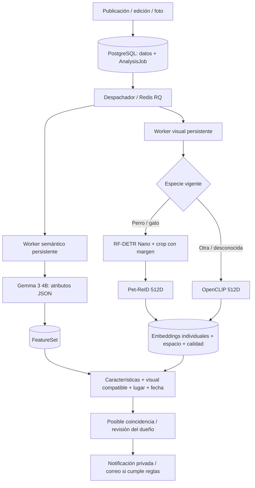

# IA local: operación y evaluación

Entrega del 15 de octubre de 2026. Ver [instalación del servidor](production.md), [licencias y hashes](third-party-models.md) e [informe de resultados](ai-delivery-report.md).

## Flujo



La API no importa Torch, OpenCLIP ni ONNX Runtime. Solo guarda y despacha trabajos. Cada worker conserva modelos en memoria entre trabajos; watchdog y leases recuperan procesos interrumpidos. La serialización de cola es JSON.

## Espacios y procesamiento

`EmbeddingSpec` reúne proveedor, modelo, revisión, dimensión y preprocessing. Su SHA-256 inmutable es `space_id`. Antes de cada comparación se comprueban el espacio de ambas filas y la procedencia del trabajo vigente. Compartir 512 dimensiones no permite comparar dos modelos distintos. Los vectores legacy se conservan y no se comparan con espacios nuevos sin generar la representación actual.

La selección de especie se centraliza en `embeddings/specs.py`: mascota, mascota del aviso, o especie de la observación. Al cambiarla se invalida la evidencia anterior y se agenda la nueva. La clave de deduplicación incluye foto, snapshot de entrada, especie relevante, proveedor, modelo, revisión y preprocessing. Cambiar crop, modelo o foto produce otro trabajo; repetir el mismo backfill no lo duplica.

Perros/gatos usan detección local, confianza mínima 0,75 y margen 18%. Ausencia de animal, detecciones ambiguas, timeout o error producen fallback a foto completa. Se registran área del animal, resolución, blur aproximado, confianza y motivo. La calidad reduce el peso de la señal visual; no rechaza una foto técnicamente válida. El VLM reutiliza la caja vigente de esa misma foto o calcula una; conserva aspect ratio, elimina EXIF, resuelve transparencia sobre blanco y limita a 1024 px/JPEG 88 sin ampliar imágenes pequeñas.

## Reglas de matching y notificación

- Se comparan todas las parejas de fotos compatibles. Una pareja usa su coseno; varias usan 0,70 × mejor + 0,30 × segunda mejor. Las fotos no se fusionan permanentemente.
- Calibración inicial: OpenCLIP floor/ceiling 0,55/0,95; Pet-ReID 0,50/0,90. Son puntos de partida conservadores, pendientes de calibración con identidad conocida.
- Con imagen: `0,45 × visual_calibrado × calidad + 0,25 × atributos + 0,20 × geografía + 0,10 × tiempo`. Sin imagen: `0,50 × atributos + 0,30 × geografía + 0,20 × tiempo`.
- Geografía: `exp(-2 × distancia_corregida / radio)`. Tiempo: `max(0,2, exp(-días / 30))`. El radio se limita por configuración y la precisión declarada tiene un tope.
- Una contradicción conocida de especie o sexo excluye la pareja. Una contradicción fuerte de especie en imagen bloquea la alerta. El avistamiento debe ser posterior a la pérdida y estar dentro de la zona de candidatos.
- Matching general: candidato ≥0,55, cobertura mínima 0,25 con foto o 0,35 sin foto, similitud de atributos ≥0,50. Notificación automática: score ≥0,82 **y** cobertura ≥0,35 **y** atributos ≥0,65 **y** geografía ≥0,35; dueño activo, aviso visible/activo, reporte de otra persona y sin rechazo/resolución previa. Se conserva la revisión humana anterior.
- Avistamiento enviado desde una ficha: siempre se conserva la notificación neutral `REPORTED_SIGHTING` para el dueño, incluso si el análisis es inconcluso. Solo se presenta `POSSIBLE_MATCH` con imagen compatible y atributos independientes suficientes; la especie heredada del aviso no constituye evidencia. Sin foto/fallo de IA: `UNVERIFIED`. Las contradicciones se muestran para revisión.
- El correo respeta cuenta confirmada, preferencias, aviso activo, agrupación, deduplicación y estado de lectura. El score nunca se llama probabilidad.

## Cola y degradación

Dos carriles: visual y semántico, cada uno con urgente, normal y backfill. Observación nueva=100; caso activo o foto de mascota con caso activo=90; mascota sin caso activo=50; histórico=10. RQ atiende primero urgente. Un trabajo ya ejecutándose no se interrumpe por otro nuevo; la demora máxima adicional depende de su timeout. El backfill no ocupa la misma cola FIFO que los avistamientos urgentes.

Matching espera hasta 30 segundos por análisis nuevo sin intento; luego continúa con evidencia parcial. Fallos/reintentos no bloquean indefinidamente. Un resultado posterior solicita recalcular. Timeouts/conectividad se reintentan con esperas; configuración inválida, checkpoint ausente, JSON inválido/truncado o imagen inválida fallan con código explícito. Publicar sigue disponible si falla un modelo. `PET_REID_ENABLED=false` selecciona OpenCLIP y agenda representaciones compatibles nuevas; no etiqueta un vector Pet-ReID como OpenCLIP.

## Configuración medida de Gemma

| Parámetro | Valor |
| --- | --- |
| Modelos texto / visión | `gemma3:4b`, manifiesto fijado |
| `OLLAMA_NUM_CTX` / `OLLAMA_NUM_PREDICT` | 4096 / 768 |
| `OLLAMA_NUM_THREADS` / `OLLAMA_NUM_PARALLEL` | 3 / 1 |
| `OLLAMA_KEEP_ALIVE` / `OLLAMA_PREWARM` | 15m / true |
| `OLLAMA_CAPABILITIES_CACHE_SECONDS` | 3600 |
| Timeout texto / visión | 120 s / 240 s |
| VLM lado máximo / JPEG | 1024 / 88 |
| Threads visuales / detector semántico | 2 / 1 |

`/api/show` se cachea por URL, modelo y configuración. En producción se verifica además el digest de Gemma. Prewarm usa lock Redis, comprueba disponibilidad y carga sin una generación larga; el fallo queda observable y no detiene FastAPI. Keep-alive de 15 minutos mantiene el modelo entre trabajos cercanos y permite liberar memoria en inactividad. Cambiar variables requiere recrear los servicios.

## Comandos privados

Ejecutar desde la raíz del servidor, con Docker y `.env.production`. El alias siguiente solo simplifica los ejemplos:

```sh
dc() { docker compose -p mascomatch --env-file .env.production -f compose.production.yml --profile ai-local "$@"; }
dc run --rm --no-deps model-setup python -m app.embeddings.setup --check
dc run --rm --no-deps model-setup python -m app.analysis.gemma_setup --check
dc run --rm --no-deps worker python -m app.embeddings.backfill
dc run --rm --no-deps worker-ai python -m app.analysis.backfill
dc exec -T api python -m app.ops.release_check
python3 tools/production_apply.py smoke
```

El smoke crea y elimina una base y objetos temporales; requiere el rol operador solo dentro de su contenedor, sin claves SMTP ni de sesión. Verifica dog/cat/rabbit/unknown, vectores reales, Gemma texto/imagen, matching, outbox sin envío, Redis, PostGIS/pgvector y backfill. Son fixtures técnicas, no un dataset de eficacia. Las pruebas de fallos controlados y de espacios incompatibles están en la suite sin modelos.

Para comparar configuraciones Gemma, montar fotos públicas/propias en `/evaluation` y una carpeta de salida privada y escribible en `/results`. No ejecutar el benchmark de cold-start mientras se atienden usuarios: descarga el modelo de RAM deliberadamente.

```sh
dc run --rm --no-deps -v "$PWD/real-data:/evaluation:ro" -v "$PWD/real-data/results:/results" worker-ai \
  python -m app.analysis.benchmark --images /evaluation/dog.jpg /evaluation/cat.jpg \
  --repeats 2 --cold --crop --parallel --output /results/gemma.json
```

`--current` prueba solo la configuración vigente. Sin él compara 8192/4096/1024, 4096/512/768 y 4096/768/1024 (contexto/salida/lado). El reporte separa JSON, truncamientos, known/unknown, comprobaciones de atributos etiquetados, cold/warm y dos peticiones simultáneas. La RAM del cliente **no** es la RAM de Ollama.

## Etiquetas y eficacia futura

```sh
dc run --rm --no-deps -v "$PWD/real-data/results:/results" worker \
  python -m app.matching.export_labels /results/owner-labels.json
dc run --rm --no-deps -v "$PWD/real-data:/evaluation:ro" -v "$PWD/real-data/results:/results" worker \
  python -m app.matching.evaluate_visual /evaluation/dataset.json --provider both \
  --openclip-threshold 0.87 --pet-reid-threshold 0.82 --split test --output /results/visual.json
```

El exportador crea un archivo privado y no sobrescribe uno existente. Incluye pares de fotos que el dueño asignó a su mascota y feedback explícito `RESOLVED`/`FALSE_MATCH` del dueño. Excluye eventos legacy, dudosos, de otros actores, fotos agregadas después del feedback y contradicciones entre etiquetas. No exporta contactos ni vectores. No entrena automáticamente.

Formato inicial en `test-data/matching/visual-dataset.example.json`. Usar fotografías diferentes, identidades conocidas y negativos parecidos; nunca la misma foto en galería y consulta ni la misma identidad entre entrenamiento/calibración/test. El evaluador rechaza bytes duplicados y rutas fuera del dataset. Top-k se calcula por identidad; Recall@k coincide con Top-k al existir una identidad relevante por consulta. FPR usa todas las parejas negativas y el umbral separado de cada proveedor. Los umbrales de ejemplo no están calibrados. El evaluador mide señal visual; `real_evaluate` anterior evalúa el pipeline combinado usando atributos suministrados.

## Métricas y límites

`/health/ready`: DB, Redis, bucket. `/internal/ready/ai`: además workers, modelos y Gemma, con bearer de monitoreo y bloqueado por Caddy. No hace inferencia. La instalación valida hashes completos; el health liviano comprueba presencia/tamaño y digest Gemma.

`/internal/metrics` expone p50/p95 por fase y tipo, cola/antigüedad/urgencia, finalizados por minuto, reintentos, timeouts, JSON/truncamientos, cold-start, prewarm, crop y disponibilidad. Ventana de 24 h limitada a los 10.000 trabajos iniciados más recientes; cada job conserva último intento y contadores agregados, no una traza por intento. No se registran fotos, texto privado, credenciales ni contenido de tokens. Hay siete reglas Prometheus, incluidas IA no disponible y urgente atrasado.

El servidor es CPU: una imagen Gemma tarda decenas de segundos. El piloto necesita un límite de carga acorde a sus tiempos y monitoreo de cola. No se midió todavía precisión de identidad en casos reales ni capacidad del futuro VPS; las cifras de esta entrega corresponden al equipo local y fixtures pequeñas.
